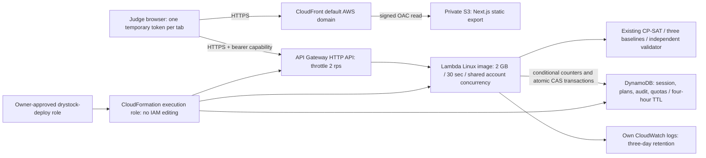

# DryStock AWS architecture — deployed demo

**Existing stack updated 11 October 2026:** [public DryStock](https://d38gzj2yabm82w.cloudfront.net), API `https://x59yh2i1yf.execute-api.ap-south-1.amazonaws.com`, stack `drystock-demo` in ap-south-1. Both Lambda and frontend include commit `1d5e337`. The reviewed processed-template difference was only the Lambda image URI; all resource IDs, parameters, permissions and capacities were preserved. See [deployment evidence and limitations](DEPLOYMENT.md).

This is the actual deployed execution path. The existing bootstrap supplies separated roles, private artifacts/ECR and the OAC; it was not updated during this release. `sam/cloud-template.yaml` defines the existing bounded application stack. The frontend is a static export; API requests bypass Next rewrites through the public endpoint. CORS limits browser origins; bearer capabilities enforce session isolation. These temporary tokens protect demo state, not production accounts.

Tokens contain 256 random bits and are retained in `sessionStorage` for reload persistence within one tab. DynamoDB keys use SHA-256 hashes rather than token secrets. Every stateful API request loads its own partition and checks absolute expiry independently of delayed TTL deletion. Separate plan IDs are checked against that partition's active plan. No session ID enters a URL or server log.

Authoritative scenario, revision, latest plan and the most recent 30 audit events live in a state item. Plan generation snapshots occupy separate items; history reads the latest 30 within the same partition. Atomic transactions update the state with an internal version condition and current/historical plan status together. User revision checks protect scenario changes; internal versions also prevent races between approval and generation when user revisions have not advanced. Full completed resources remain in the scenario. Optimisation does not modify state until independent output validation and the conditional transaction pass.

SQLite remains the local development adapter. Shared `workflow.py` validates approval, completion and disruption for both storage implementations; `engine.py` invokes the same optimiser and baselines for local, SAM and cloud paths. The local stateless SAM template is retained. The cloud container adds boto3 and the unchanged fixture; it imports neither FastAPI nor SQLite.

State and history expire after four hours; quota counters have their own expiry. Request, compute and new-session quotas are backend-enforced conditional writes. Failed attempts consume compute quotas. Lambda uses the account's shared unreserved concurrency pool, allowing deployment with an account limit of 10 without a function reservation. DryStock no longer has its own cap of 2 simultaneous executions; other functions' reservations and activity can reduce its available capacity. The account concurrency limit and API throttle bound throughput; they do not form an absolute AWS cost cap. DDB writes can throttle with fixed capacity; the UI reports failures and does not substitute local compute.

`POST /api/scenario` validates bounded operator assumptions server-side and writes only the current session. Inputs cannot include completed work. Saving or resetting starts a new scenario epoch and leaves no active plan; former plans are superseded historical snapshots. Approval, completion, disruption, quotas, leases and independent result validation use the existing transaction and revision checks.

Live API verification covered sample/custom workflows, reload persistence, isolation, validation and reset. Overlapping tests produced real DynamoDB throughput failures with the preserved 5 RCU / 5 WCU table. Even GET charges the request counter on the full state item; capacity can be consumed quickly. The UI recovered via an explicit state refresh and kept stale execution controls disabled. Direct table/configuration/IAM inspection is restricted by deployment-profile permissions; configured limits and resource identities were checked using CloudFormation. Shared account concurrency reports 1,000. Detailed evidence and browser scope are in [DEPLOYMENT.md](DEPLOYMENT.md) and [the release report](artifacts/cloud-update/REPORT.md).
