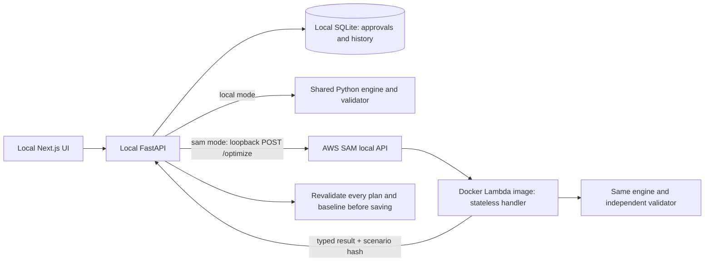

# AWS SAM reproduction

This is actual **local AWS SAM execution**, not an AWS cloud deployment. The stateless Lambda-compatible handler invokes the same OR-Tools engine and three baselines as FastAPI. SQLite, approval, completion and audit history stay in FastAPI. No AWS credentials, account changes or deployment were used.



The SAM image/template are prepared for possible future Lambda image deployment. Cloud API Gateway, ECR hosting, authentication, frontend hosting and a cloud database have **not** been deployed or configured. Do not expose this unauthenticated demonstration publicly.

## Install

From the repository root in PowerShell, install Docker Desktop from its official distribution, start its Linux engine, and install Python 3.12–3.14 and Node.js 20.9+. This workspace requires `rtk` command wrapping. SAM may also be installed using the [official installer](https://docs.aws.amazon.com/serverless-application-model/latest/developerguide/manage-sam-cli-versions.html). The verified isolated installation was:

```powershell
rtk proxy python -m venv .venv
rtk proxy .\.venv\Scripts\python.exe -m pip install -r backend\requirements.lock.txt
rtk proxy python -m venv .sam-venv
rtk proxy .\.sam-venv\Scripts\python.exe -m pip install aws-sam-cli==1.168.0
rtk proxy npm.cmd --prefix frontend ci
rtk proxy docker version
rtk proxy .\.sam-venv\Scripts\sam.exe --version
```

No Windows virtual environment is copied into the function. `sam/Dockerfile` installs Linux binary wheels inside the official Python 3.12 Lambda image. Target: **linux/amd64, x86_64**. Verified runtime: Python **3.12.15**, OR-Tools **9.15.6755**, Pydantic **2.14.0**. OR-Tools installs its native wheel and dependencies including numpy, pandas, protobuf, absl-py, typing-extensions and immutabledict; Pydantic includes pydantic-core. Direct versions are pinned in `sam/requirements.txt`; the Python 3.12 base tag and transitive dependencies may receive updates. Runtime versions are returned in every result. The verified image ID began `5bb02100ea7d`.

Memory: **2,048 MB**. Lambda timeout: **30 seconds**. Application solver budget: **5 seconds**, configurable 0.01–10; handler reserves two seconds when Lambda reports remaining time. Baselines and validation also require time. Limits: 30 lots, 6 workers, 3 forklifts, 6 tarps and 6 bays. These are demo safeguards, not production latency guarantees.

## Build, invoke and verify

```powershell
rtk proxy powershell -NoProfile -File sam\Invoke-Verify.ps1
```

The script sets `SAM_CLI_TELEMETRY=0`, `AWS_EC2_METADATA_DISABLED=true`, and `AWS_DEFAULT_REGION=ap-south-1` in its process; prepares the two historical events; then actually executes:

```powershell
rtk proxy .\.venv\Scripts\python.exe sam\prepare_events.py
rtk proxy .\.sam-venv\Scripts\sam.exe validate --lint --template-file sam\template.yaml
rtk proxy .\.sam-venv\Scripts\sam.exe build --template-file sam\template.yaml
rtk proxy .\.sam-venv\Scripts\sam.exe local invoke ProtectionFunction --template-file .aws-sam\build\template.yaml --event sam\events\original.json --log-file artifacts\sam-original-runtime.log
rtk proxy .\.sam-venv\Scripts\sam.exe local invoke ProtectionFunction --template-file .aws-sam\build\template.yaml --event sam\events\disruption.json --log-file artifacts\sam-disruption-runtime.log
```

The wrapper runs `sam/verify_response.py` after each invocation. It parses the real Lambda response, independently checks all schedules and totals, and compares modelled outcomes against local execution. Retained logs contain Lambda START/END/REPORT and actual JSON responses; comparison JSON files report `outcomes_match: true`. Exact worker assignments and start times can differ between platforms while validated optimal values match. Direct Python handler tests alone do not establish SAM execution.

## Run the complete demo

Terminal 1, from the repository root:

```powershell
rtk proxy powershell -NoProfile -File sam\Start-Api.ps1
```

This actually runs `sam local start-api --template-file .aws-sam/build/template.yaml --host 127.0.0.1 --port 3001`. Keep Docker and this terminal running.

Terminal 2:

```powershell
rtk proxy powershell -NoProfile -File .\Start-DryStock.ps1 -ComputeBackend sam -Database artifacts\phase2-demo.sqlite3 -BackendPort 8001 -FrontendPort 3002
```

Open [demo](http://127.0.0.1:3002). Alternate ports and a separate database preserve any existing local app. Reset the **isolated demo yard** if it already contains a previous run. Generate → compare original strategies → approve → record **L02** complete → trigger demo disruption → generate again → inspect before/after → compare strategies. Completion attests scheduled execution, advances the simulated clock to 12 and keeps tarp T2 occupied. Cutoff becomes 35 and forklift F1 becomes unavailable. Approve the revised draft only after review. See [recording script](../DEMO_SCRIPT.md).

The UI identifies the selected backend separately from the backend that produced the saved result. SAM failures return 503 and do not silently run locally. The FastAPI adapter verifies scenario identity, all tasks, baseline totals and output provenance before storing. These provenance fields are diagnostic evidence, not cryptographic remote attestation.

Capture the finished UI workflow (read-only):

```powershell
rtk proxy .\.venv\Scripts\python.exe sam\capture_demo.py --port 8001
```

To use local compute, stop terminal 2 and restart the same launcher with `-ComputeBackend local`. `DRYSTOCK_COMPUTE_BACKEND` controls manual FastAPI launches; `DRYSTOCK_SAM_URL` defaults to `http://127.0.0.1:3001/optimize` and permits only loopback HTTP. SAM never writes SQLite.

## Contract and failure semantics

Direct events contain `{ "scenario": ..., "solver_seconds": 5 }`; API Gateway uses that JSON body. Output schema version 1 includes `plan`, `comparisons`, `execution_backend`, `scenario_sha256`, `assumptions`, and runtime versions. Plans include status, assignments, integer start/end times, validation, benefits, residual loss, bound and solve duration.

Malformed JSON returns 400; invalid scenarios/history return 422. No usable solver result (including UNKNOWN/INFEASIBLE) returns 503; a valid empty schedule can be OPTIMAL. FEASIBLE returns an independently validated incumbent without an optimality claim. Insufficient invocation time returns 504; unexpected errors return sanitized 500. Model outcomes are fictional, scheduled kilograms are not measured waste prevented, and simulated completion is not physical evidence.

AWS references: [local invoke](https://docs.aws.amazon.com/serverless-application-model/latest/developerguide/sam-cli-command-reference-sam-local-invoke.html), [Python Lambda container images](https://docs.aws.amazon.com/lambda/latest/dg/python-image.html).
